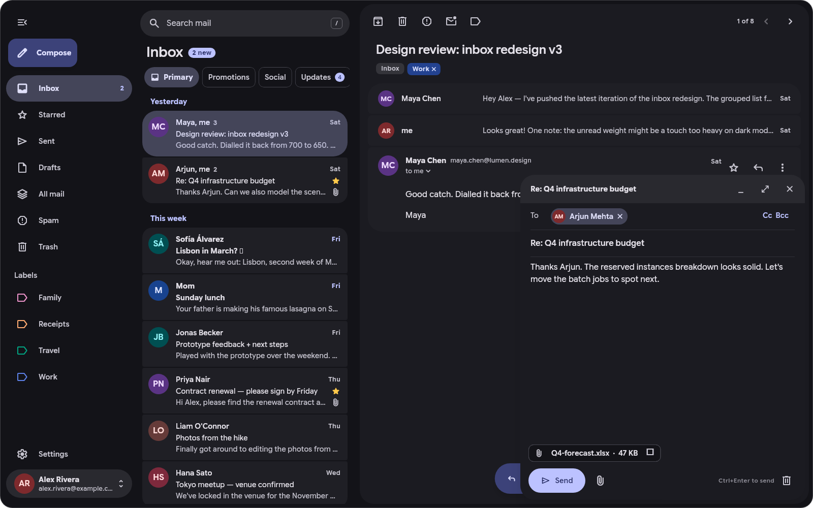

#  Plume

A fast mail client for the Linux desktop, built with Flutter and Material 3 Expressive. It supports Gmail and any IMAP/SMTP server, multiple accounts, real-time notifications and a system tray icon.

<picture>
  <source media="(prefers-color-scheme: dark)" srcset="assets/screenshots/showcase_dark.png">
  <source media="(prefers-color-scheme: light)" srcset="assets/screenshots/showcase_light.png">
  
</picture>

> [!NOTE]
> Plume is vibe-coded with AI assistance. Expect rapid iteration and occasional rough edges. Feedback, bug reports, and contributions are welcome.

## Features

- Unified inbox across accounts, with Gmail categories
- Gmail API or any IMAP/SMTP server, with automatic server discovery
- Local SQLite cache, optimistic actions that replay when back online, and offline reading
- Push notifications via IMAP IDLE, with Open, Archive and Mark as read actions
- Tray icon with unread count; closing the window keeps Plume running
- HTML mail rendered by WebKit, as in other mail apps; simple mail follows the app's light or dark theme
- Remote images blocked by default; tracking pixels removed
- Compose with rich-text formatting (text size and colour, nested lists, quotes and indents), autocomplete, attachments, drafts, undo send and per-account signatures
- Instant local search, with server search on Enter
- Gmail-style keyboard shortcuts
- Opens `mailto:` links as the system's default mail app
- Follows the desktop's light/dark mode and accent colour
- Draws its own title bar, with minimise, maximise and close buttons where your desktop puts them (`gtk-decoration-layout`): drag it to move the window, double-click to maximise, right-click for the window menu. *Settings → Appearance → Title bar* switches to the desktop's title bar, or to none (the default on tiling compositors)

## Install

Requires Flutter 3.47+, `clang`, `cmake`, `ninja`, `pkgconf`, `gtk3`, `webkit2gtk-4.1` and `libsecret`.

```sh
tool/install.sh                                              # build and install to ~/.local
tool/install.sh --client ~/Downloads/client_secret_XXXX.json  # also install a Google OAuth client
```

Launch **Plume** from your app launcher, or run `plume`.

**Start on login:** GNOME, KDE, XFCE and Cinnamon use *Settings → Start on login*. On Hyprland, Sway and similar compositors, add `~/.local/bin/plume --background` to your startup commands.

**Default mail app:** choose *Settings → Default mail app → Make default* in Plume, or pick Plume as the email client in your desktop's settings (KDE: *System Settings → Default Applications*; GNOME: *Settings → Apps → Default Apps*). From a terminal, run `xdg-mime default org.atinus.plume.desktop x-scheme-handler/mailto`. Email links then open a new message in Plume, whether or not it is already running. If Plume isn't listed, run `tool/install.sh` again to update its launcher entry.

## Adding accounts

**Other mail (IMAP/SMTP)**: enter your name, address and password. Plume discovers the server settings and verifies the login before saving. Most providers require an app password:

| Provider | Where to create one |
|---|---|
| Gmail | <https://myaccount.google.com/apppasswords> (requires 2-Step Verification) |
| iCloud | <https://account.apple.com> |
| Yahoo, AOL, Fastmail | Account security settings |

Outlook.com, Hotmail and Microsoft 365 are not supported.

**Google sign-in** uses the Gmail API and needs an OAuth client. You set one up once in the [Google Cloud Console](https://console.cloud.google.com/):

1. **Create a project**, then open **APIs & Services → Library**, find **Gmail API** and click **Enable**. Without it, sign-in works but mail doesn't load.
2. Open **Google Auth Platform**. If it says it isn't configured yet, click **Get started**, enter `Plume` and your email, choose **External** as the audience, and finish.
3. **Branding:** fill in the fields below. Google won't let you publish without the home page and privacy policy links.
   - **App name:** `Plume`
   - **User support email** and **Developer contact email:** your address
   - **Application home page** and **Application privacy policy link:** public pages on a site you own, such as a free GitHub Pages site (`yourname.github.io`)
   - **Authorized domains:** the domain of those two links
   - Leave **App logo** empty. Google doesn't show it until the app is verified, and adding one starts verification.
4. **Audience:** check that the user type is **External**, click **Publish app** and confirm. The status should read **In production**. Leave the app unverified; verification isn't needed for personal use. Apps left in *Testing* make you sign in again every 7 days.
5. **Data access → Add or remove scopes:** tick `https://mail.google.com/`, `.../auth/userinfo.email`, `.../auth/userinfo.profile` and `openid`, click **Update**, then **Save**. If `https://mail.google.com/` isn't listed, the Gmail API from step 1 isn't enabled yet.
6. **Clients → Create client:** choose **Desktop app**, click **Create**, then download the JSON from the dialog that opens. Google shows the client secret only once, so download it before closing the dialog.
7. In Plume, add an account and choose **Google → Choose client file…**, then pick the JSON. You can also pass it to `tool/install.sh --client`. Plume saves a copy, so you only do this once.
8. Choose **Google** again to sign in. Your browser opens and Google warns *"Google hasn't verified this app"*, which is expected because the client is your own. Choose **Advanced → Go to Plume (unsafe)**, allow every permission Google lists, and continue.

You can give the same JSON to other people so they skip these steps, or build Plume with it (`--dart-define=PLUME_GOOGLE_CLIENT_ID=… --dart-define=PLUME_GOOGLE_CLIENT_SECRET=…`) so nobody needs the file. Everyone then signs in through your project. An unverified project can be used by at most 100 Google accounts over its lifetime, and that count never resets. Google deletes OAuth clients that go unused for 6 months; a deleted client can be restored for 30 days.

| Problem | Fix |
|---|---|
| **Publish app** is greyed out | Fill in the home page and privacy policy links on **Branding** (step 3). |
| *Access blocked: Plume has not completed the Google verification process* (Error 403: access_denied) | The app is still in *Testing*. Publish it (step 4). |
| Plume says some permissions were unticked | Sign in again and allow every permission on Google's screen. |
| Signed in, but no mail loads | Enable the Gmail API (step 1). |
| The JSON wasn't downloaded and Google no longer shows the secret | Create another Desktop app client (step 6). |

## Data locations

| Data | Location |
|---|---|
| Mail cache | `~/.local/share/plume/mail.sqlite` |
| Google client | `~/.config/plume/google-oauth-client.json` |
| Tokens and passwords | System keyring, or a private file if none is available |
| Autostart entry | `~/.config/autostart/org.atinus.plume.desktop` |
| Default mail app | `~/.config/mimeapps.list` |
| Graphics engine (Settings → System) | `~/.local/share/plume/graphics-engine` |

## Architecture

A Dart pub workspace. Provider and store interfaces are kept separate so new providers and platforms can be added.

| Package | Purpose |
|---|---|
| `app` | Flutter app (Riverpod) and GTK runner, which renders HTML mail with WebKitGTK |
| `packages/plume_core` | Mail model, provider and store contracts, sync engine, operation queue, outbox |
| `packages/plume_gmail` | Gmail API provider with OAuth (PKCE) and incremental sync |
| `packages/plume_imap` | IMAP/SMTP provider, threading and server discovery |
| `packages/plume_mime` | MIME parsing and building |
| `packages/plume_store` | SQLite storage (drift), full-text search |
| `packages/plume_linux` | D-Bus integration: tray, notifications, portal, autostart, default apps |
| `packages/plume_design` | Material 3 Expressive components and theme |

## Development

```sh
export PATH=$HOME/development/flutter/bin:$PATH
cd app

flutter run -d linux --dart-define=PLUME_DEMO=true    # demo account, no Google client needed
flutter test                                          # app tests
build/linux/x64/debug/bundle/plume 'mailto:me@example.org?subject=Hi'  # open a link (also in a running instance)
(cd ../packages/plume_imap && dart test)              # package tests; same for the other packages
../packages/plume_imap/tool/integration.sh            # IMAP against Dovecot in rootless podman
```

Set `PLUME_ALLOW_MULTIPLE_INSTANCES=1` to run more than one instance during development.

Judge smoothness only in profile or release builds (`flutter run --profile -d linux`); debug builds always stutter. Flutter's frame timings and DevTools can't see frames that reach the screen late, so measure those with the frame probe:

```sh
flutter build linux --profile -t tool/frame_probe/main.dart
PLUME_ALLOW_MULTIPLE_INSTANCES=1 WAYLAND_DEBUG=client build/linux/x64/profile/bundle/plume app \
  > /tmp/p.out 2> /tmp/p.wl
python3 tool/frame_probe/pacing.py /tmp/p.out /tmp/p.wl   # also: minimal, idle
```

## Known limitations

- GNOME needs the AppIndicator extension to show the tray icon
- Plume only builds its screen-reader tree while AT-SPI reports an assistive technology (`org.a11y.Status`, as Qt and the browsers check), because Flutter's Linux embedder would otherwise update it on every animation frame. Set `GNOME_ACCESSIBILITY=1` to force it on.
- Snooze and scheduled send are unavailable for Gmail
- IMAP accounts: restoring a conversation from Trash moves all of it to the Inbox
